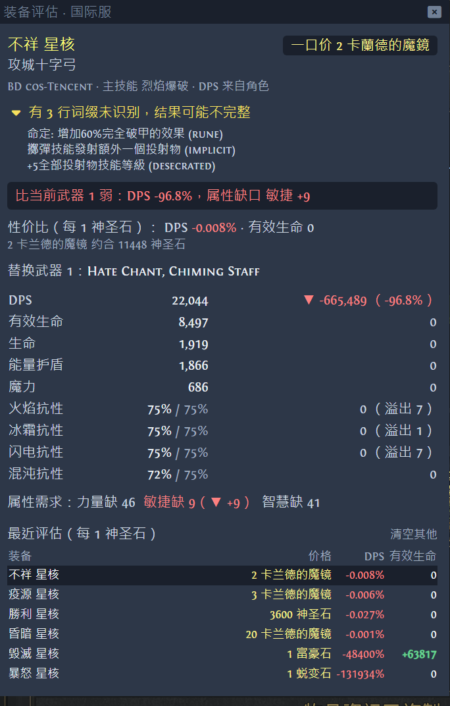
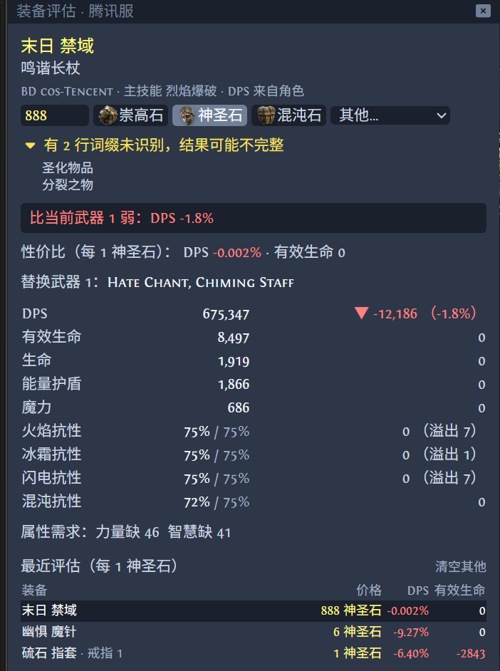
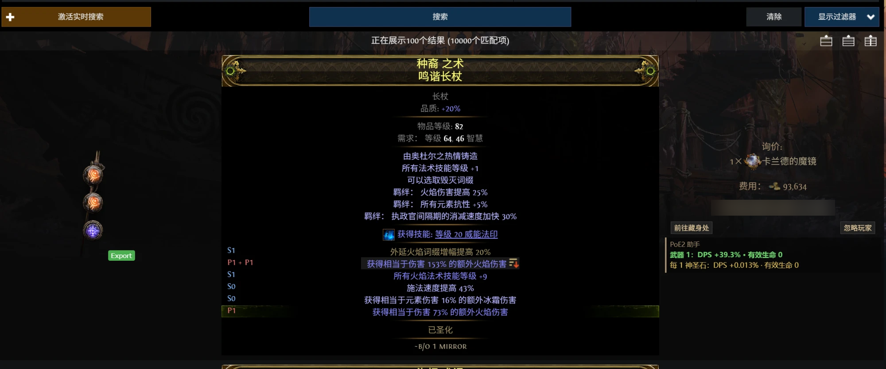

# PoE2 配装助手（PoE2-Build-Assistant）

给《流放之路 2》玩家的 Windows 工具：**全中文的 Path of Building（PoB）** 加一个 **游戏内装备评估浮层**。鼠标指向一件装备按快捷键，就能看到它换到你当前 BD 上之后 DPS、有效生命、抗性和属性的变化；查价、买装备也都围绕“对我的 BD 提升多少”来做。国际服和国服（腾讯）都支持。

> English: a Windows companion for Path of Exile 2. It ships a fully Simplified-Chinese Path of Building (PoE2) and an in-game overlay that shows how a hovered item changes the build you have open in PoB (DPS, EHP, resistances, attributes). Works on both the international and the Tencent (China) servers. Price checks and trade searches are ranked by upgrade per currency. Game terms come from PoE2DB only.

## 功能

- **两服装备评估浮层**：游戏里指向背包、仓库或市集中的装备，按 `Ctrl+Shift+D`，弹出中文浮层：各个可放的槽位（戒指、武器两个都算）的 DPS 百分比、有效生命、生命/能量护盾、抗性（含上限与溢出）、属性与精魂缺口，并给出一句总结。评估用的是 **PoB 当前打开的 BD，包括还没保存的修改**；PoB 关着时用最近打开的 BD 文件。自动识别当前是国际服还是国服客户端。
  - `Ctrl+Shift+V` 评估剪贴板里的装备文本；市集里点“复制”也会自动评估（可关）。
  - `Ctrl+Shift+A` 把装备加进 PoB 当前 BD 的物品列表（不穿上、不保存），方便继续在 PoB 里比较。
- **PoB 全汉化**：菜单、控件、计算页、配置页、提示等界面文字，以及技能、天赋、装备、词缀、物品库全部显示简体中文；支持中文输入、粘贴和中文搜索。游戏术语一律用[流放编年史](https://poe2db.tw/cn/)的译名，不自行翻译。
- **查价与 PoB 市集交易**：PoB 自带的市集交易（Trader）支持国服；按当前 BD 和槽位生成市集筛选，搜出候选后逐件试穿，按“每 1 神圣石带来的提升”排序。浮层显示挂单价和性价比，跨通货用同服同赛季的汇率换算（国际服取自 poe.ninja，国服可在 PoB 选项里填写）。
- **自带市集窗口**：助手里直接打开官方市集网页，每条结果旁显示这件装备对当前 BD 的试算和性价比。
- **导入国服角色**：在 PoB 导入页贴 WeGame 分享链接，导入装备、天赋、珠宝和技能。
- **MCP（在 Claude、ChatGPT、Cursor、Gemini 等 AI 客户端里问 BD）**：安装包带 [POBG](https://github.com/Michael-crazy/POBG)，通过本地 MCP 用中文查询技能、天赋、词缀，生成 BD（带 PoB 导入码），或读取“我 PoB 里当前 BD 的 DPS 和抗性”。数字由包里的 PoB 引擎计算。双击包里的 `显示MCP配置.cmd` 得到各客户端（Claude Code/桌面版、Cursor、VS Code、Gemini CLI、Codex、ChatGPT 桌面版、Cherry Studio）的配置写法。
- **导出 .build**：复用 PoB 上游功能导出游戏内 Build Planner 可读取的文件。

## 效果截图

游戏内装备评估浮层：和当前武器逐项对比，给出性价比，并保留最近评估的装备做对照。

| 国际服（价格从市集复制文本读取） | 国服（价格在浮层里输入） |
|---|---|
|  |  |

助手自带的市集窗口（国服）：每条挂单右侧显示这件装备对当前 BD 的提升和每 1 神圣石的性价比。



## 下载安装

1. 到 [Releases](https://github.com/Michael-crazy/PoE2-Build-Assistant/releases)（发布后开放）下载最新的 Windows ZIP。
2. 解压到一个普通文件夹（不要放在 `C:\Program Files` 这类需要管理员权限才能写入的位置）。
3. 双击 `启动中文PoB.cmd`。PoB 以简体中文打开，游戏内助手在后台启动，托盘里出现图标；关掉 PoB，助手随之退出。
4. 在 PoB 里打开或导入 BD，进游戏按 `Ctrl+Shift+D`。助手的快捷键、服务器和语言、浮层选项都在 PoB“选项”的“助手”分组里。

安装包自带 Python，不需要另装任何东西。国服客户端以管理员身份运行时，助手会提示并可经 UAC 以管理员重启。

## 仓库关系

| 仓库 | 内容 |
| --- | --- |
| **本仓库** | Python 后端（试算服务、装备文本解析、查价与性价比、国服角色导入、MCP 工具）、编年史术语数据、打包与维护脚本、测试 |
| [Michael-crazy/PathOfBuilding-PoE2](https://github.com/Michael-crazy/PathOfBuilding-PoE2) | PoB fork，分支 `poe2-assistant`：汉化、中文输入、助手桥接与设置、国服市集交易。也是助手的试算引擎 |
| [Michael-crazy/Exiled-Exchange-2](https://github.com/Michael-crazy/Exiled-Exchange-2) | Exiled Exchange 2 fork，分支 `poe2-assistant`：游戏内快捷键与评估浮层、自带市集窗口 |
| [Michael-crazy/POBG](https://github.com/Michael-crazy/POBG) | POBG fork：简体中文数据与 Windows 原生运行，提供 MCP |
| [Michael-crazy/poe-trade2text](https://github.com/Michael-crazy/poe-trade2text) | 市集预览脚本的来源（助手自带市集窗口复用其解析代码） |

PoB 与 EE2 的改动都是叠在固定上游提交上的补丁提交，跟随上游时变基，见 [sources/pob-branch.md](sources/pob-branch.md)。各模块的接口说明在 [`sources/`](sources/)：

- [助手外壳与后端接口](sources/assistant-shell.md)、[PoB 试算契约](sources/pob-trial-contract.md)、[提升指标](sources/upgrade-value.md)
- [PoB 汉化数据](sources/pob-localization.md)、[术语规则](sources/terminology.md)、[装备文本解析](sources/equipment-clipboard.md)
- [市集预览接口](sources/web-preview.md)、[国服市集调研](sources/tencent-trade-research.md)、[整套估价](sources/build-estimate.md)
- [MCP 输入校验](sources/guide-mcp.md)、[攻略输入契约](sources/guide-input-contract.md)

## 数据来源与许可

- 本仓库代码：[MIT](LICENSE)。
- 游戏术语数据（`data/`）：来自[流放编年史 PoE2DB](https://poe2db.tw)，按 **CC BY-NC-SA 3.0**（署名、非商业、相同方式共享）发布，详见 [data/DATA-LICENSE.md](data/DATA-LICENSE.md)。代码本身按 MIT 许可；附带的编年史数据**仅限非商业用途**，含这些数据的发布包同样不能用于商业用途。
- PoB 界面译法部分参考 PoeCharm 与 PathOfBuilding-PoE2-i18n；PoB、EE2、POBG、poe-trade2text 均为 MIT；安装包内置 CPython（PSF 许可）与 Electron/Chromium。完整声明见 [THIRD-PARTY-NOTICES.md](THIRD-PARTY-NOTICES.md)。
- Path of Exile 的游戏内容版权属于 Grinding Gear Games。本项目是社区工具，与 Grinding Gear Games、腾讯无关。

## 参与开发

欢迎提 Issue 和 PR，请先读 [CONTRIBUTING.md](CONTRIBUTING.md)。最快的上手方式：

```sh
python3 -B -m unittest discover -s scripts -p 'test_*.py'
python3 -B -m unittest discover -s ops -p 'test_*.py'
```

需要 Python 3.12。需要真实 PoB 引擎的测试在没有引擎时自动跳过；如何准备引擎见 [sources/README.md](sources/README.md) 和 [sources/pob-user-runtime.md](sources/pob-user-runtime.md)。
